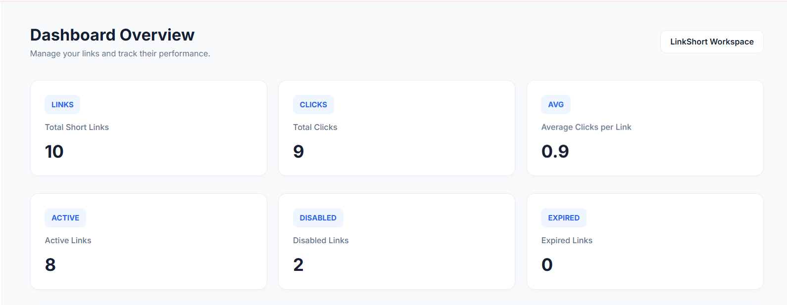
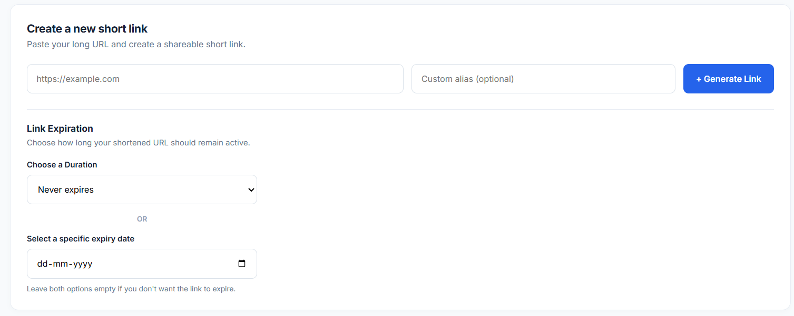
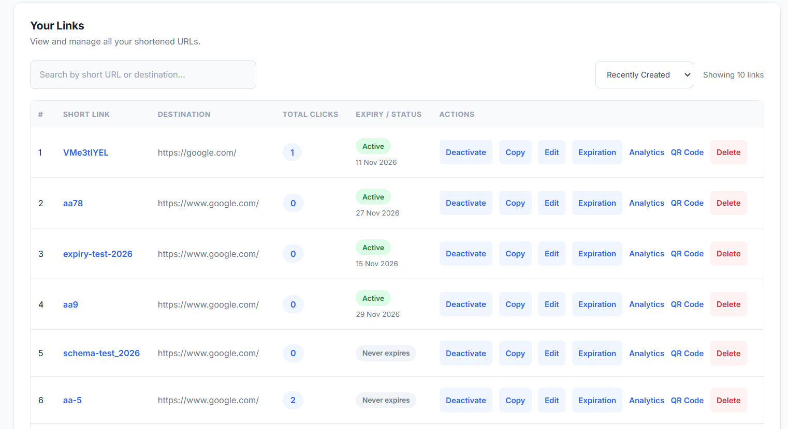
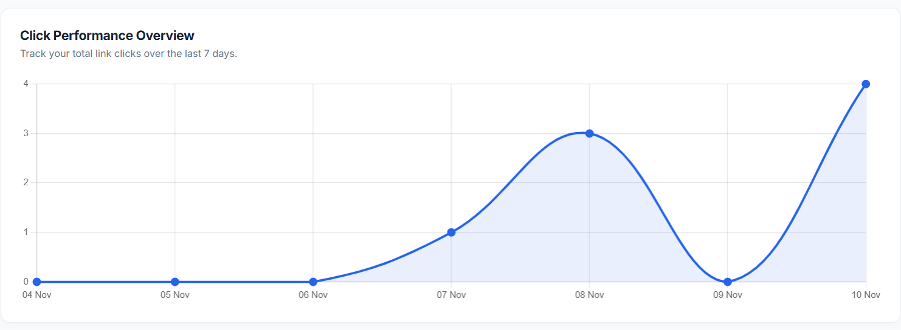
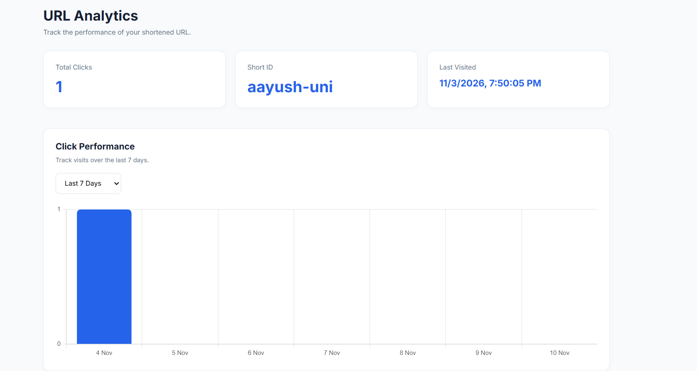
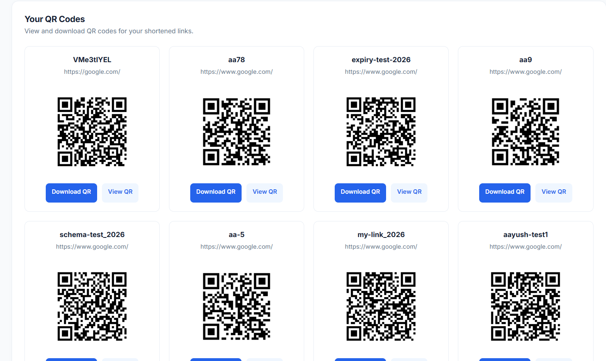

# LinkShort — URL Shortener & Analytics Platform

A full-stack URL shortening platform built with **Node.js, Express.js, MongoDB, and EJS**. Create custom short links, manage URLs, generate QR codes, and monitor link performance through an analytics dashboard.

**Live Demo:** [LinkShort](https://linkshort-jlnb.onrender.com)  
**Source Code:** [GitHub Repository](https://github.com/apradhan47/LinkShort)

---

## Overview

LinkShort makes long URLs easier to share and manage. It provides a centralized dashboard where users can create shortened URLs, customize aliases, manage link expiration, generate QR codes, and track engagement.

The application includes individual link analytics as well as an overall dashboard for monitoring URL performance.

## Application Screenshots

### Dashboard Overview

View overall link performance, total clicks, active links, disabled links, and expired links.



### Link Generation

Create shortened URLs with custom aliases and configurable expiration settings.



### URL Management

Search, sort, edit, copy, activate, deactivate, and delete shortened URLs.



### Analytics Dashboard

Monitor click performance and analyze individual URL engagement.





### QR Code Generation

Generate, view, and download QR codes for shortened URLs.



## Features

- **URL Shortening:** Convert long URLs into short, shareable links.
- **Custom Aliases:** Create personalized short URLs.
- **Link Management:** View, edit, activate, deactivate, and delete shortened URLs.
- **Click Tracking:** Record and monitor visits to shortened links.
- **Analytics Dashboard:** View total links, clicks, active links, disabled links, and expired links.
- **Individual Link Analytics:** Track click activity over 7-day and 30-day periods.
- **Traffic Insights:** Visualize device, browser, and referrer statistics.
- **QR Code Generation:** Generate, view, and download QR codes for shortened links.
- **Link Expiration:** Set predefined expiration periods or choose a custom expiry date.
- **Search and Sorting:** Find links and organize them by creation date, clicks, or alphabetical order.
- **Input Validation:** Validate destination URLs and custom aliases.
- **Rate Limiting:** Protect URL creation and redirection endpoints against excessive requests.

## Tech Stack

| Category            | Technologies               |
| ------------------- | -------------------------- |
| Backend             | Node.js, Express.js        |
| Frontend            | EJS, HTML, CSS, JavaScript |
| Database            | MongoDB, Mongoose          |
| Charts              | Chart.js                   |
| QR Codes            | qrcode                     |
| Short ID Generation | shortid                    |
| Security            | express-rate-limit         |
| Deployment          | Render                     |

## Project Structure

```text
LinkShort/
├── controllers/
│   └── url.js
├── middlewares/
│   └── rateLimiter.js
├── models/
│   └── url.js
├── routes/
│   ├── staticRouter.js
│   └── url.js
├── screenshots/
│   ├── dashboard.png
│   ├── link-generation.png
│   ├── url-management.png
│   ├── click-performance.png
│   ├── url-analytics.png
│   └── qr-codes.png
├── tests/
│   ├── url.test.js
│   └── rateLimiter.test.js
├── views/
│   ├── home.ejs
│   ├── analytics.ejs
│   └── qrcode.ejs
├── .gitignore
├── app.js
├── connect.js
├── index.js
├── package.json
├── package-lock.json
└── README.md
```

## Getting Started

Follow these instructions to run LinkShort locally.

### 1. Clone the repository

```bash
git clone https://github.com/apradhan47/LinkShort.git
```

### 2. Navigate to the project directory

```bash
cd LinkShort
```

### 3. Install dependencies

```bash
npm install
```

### 4. Configure environment variables

Create a `.env` file in the root directory and add:

```env
MONGODB_URI=your_mongodb_connection_string
BASE_URL=http://localhost:8001
```

Replace the MongoDB placeholder with your own MongoDB connection string.

### 5. Start the application

```bash
npm start
```

Open your browser and visit:

`http://localhost:8001`

## Automated Testing

LinkShort includes automated backend tests to verify core application functionality, API routes, URL management, redirects, analytics, and rate limiting.

**Testing Tools**

- Jest – Test framework
- Supertest – HTTP endpoint testing
- MongoDB Memory Server – Isolated database testing

**Test Coverage**

- 46 automated tests
- 2 test suites
- 83.39% line coverage
- 100% function coverage

**Run Tests Locally**

```bash
# Run all tests
npm test

# Run tests with coverage report
npm run test:coverage
```

The tests use an in-memory MongoDB database, so they do not modify your production database.

## Analytics

LinkShort provides two levels of analytics:

- **Dashboard Analytics:** Overall link and click performance.
- **Individual Link Analytics:** Click history, device distribution, browser statistics, and traffic sources for each shortened URL.

## Deployment

The application is deployed on Render and uses MongoDB Atlas for persistent data storage.

**Live Application:** [https://linkshort-jlnb.onrender.com](https://linkshort-jlnb.onrender.com)

## Future Improvements

- Geographic analytics for visitor locations.
- User authentication and personalized dashboards.
- Link access protection.
- More detailed analytics and reporting.
- Improved link management and sharing capabilities.

## Author

**Aayush Pradhan**

- GitHub: [@apradhan47](https://github.com/apradhan47)

---

_Built as a full-stack web development project to explore backend development, database integration, URL management, analytics, and deployment._
